Гладышев Иван, ЛА-3

# Лабораторная №1

## Задание 1

### Задача 1 Дробная часть

#### Текст задачи

Дана сигнатура метода: public double fraction (double x); Необходимо реализовать метод таким образом, чтобы он возвращал только дробную часть числа х. Подсказка: вещественное число может быть преобразовано к целому путем отбрасывания дробной части.

Пример:

x=5,25

результат: 0,25

#### Алгоритм решения

1. Ввести вещественное число и проверить правильность ввода и допустимый диапазон.

2. Отбросить дробную часть, чтобы получить целую часть числа.

3. Вычесть целую часть из исходного числа.

4. Вывести полученную дробную часть.

#### Тестирование

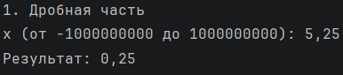

### Задача 3 Букву в число

#### Текст задачи

Дана сигнатура метода: public int charToNum (char x); Метод принимает символ х, который представляет собой один из “0 1 2 3 4 5 6 7 8 9”. Необходимо реализовать метод таким образом, чтобы он преобразовывал символ в соответствующее число. Подсказка: код символа ‘0’ — это число 48.

Пример:

x=’3’

результат: 3

#### Алгоритм решения

1. Ввести один символ и проверить, что это цифра от 0 до 9.

2. Определить числовой код введённого символа.

3. Вычесть из него код символа 0.

4. Вывести полученное число.

#### Тестирование

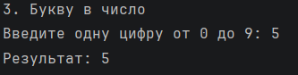

### Задача 5 Двузначное

#### Текст задачи

Дана сигнатура метода: public bool is2Digits (int x); Необходимо реализовать метод таким образом, чтобы он принимал число x и возвращал true, если оно двузначное.

Пример 1:

x=32

результат: true

Пример 2:

x=516

результат: false

#### Алгоритм решения

1. Ввести целое число и проверить правильность ввода и допустимый диапазон.

2. Проверить, находится ли число от 10 до 99 или от −99 до −10.

3. Если число находится в одном из этих диапазонов, результат — истина; иначе — ложь.

4. Вывести результат проверки.

#### Тестирование

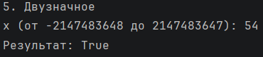

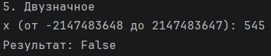

### Задача 7 Диапазон

#### Текст задачи

Дана сигнатура метода: public bool isInRange (int a, int b, int num); Метод принимает левую и правую границу (a и b) некоторого числового диапазона. Необходимо реализовать метод таким образом, чтобы он возвращал true, если num входит в указанный диапазон (включая границы). Обратите внимание, что отношение a и b заранее неизвестно (неясно кто из них больше, а кто меньше)

Пример 1:

a=5 b=1 num=3

результат: true

Пример 2:

a=2 b=15 num=33

результат: false

#### Алгоритм решения

1. Ввести две границы диапазона и проверяемое целое число. Проверить ввод и допустимые значения.

2. Выбрать меньшую границу как начало диапазона, большую — как конец.

3. Проверить, что число не меньше начала и не больше конца диапазона.

4. Вывести истину, если обе проверки выполнены, иначе — ложь.

#### Тестирование

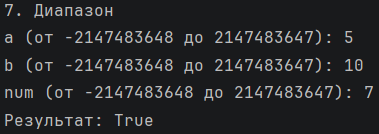

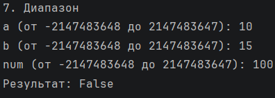

### Задача 9 Равенство

#### Текст задачи

Дана сигнатура метода: public bool isEqual(int a, int b, int c); Необходимо реализовать метод таким образом, чтобы он возвращал true, если все три полученных методом числа равны

Пример 1:

a=3 b=3 с=3

результат: true

Пример 2:

a=2 b=15 с=2

результат: false

#### Алгоритм решения

1. Ввести три целых числа и проверить правильность ввода и допустимый диапазон.

2. Сравнить первое число со вторым.

3. Сравнить второе число с третьим.

4. Если все три числа равны, вывести истину; иначе — ложь.

#### Тестирование

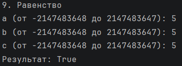

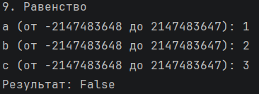

## Задание 2

### Задача 1 Модуль числа

#### Текст задачи

Дана сигнатура метода: public int abs (int x); Необходимо реализовать метод таким образом, чтобы он возвращал модуль числа х (если оно было положительным, то таким и остается, если он было отрицательным – то необходимо вернуть его без знака минус).

Пример 1:

x=5

результат: 5

Пример 2:

x=-3

результат: 3

#### Алгоритм решения

1. Ввести целое число и проверить ввод. Исключить минимальное значение типа int, модуль которого не помещается в этот тип.

2. Если число отрицательное, изменить его знак на противоположный.

3. Если число равно нулю или положительное, оставить его без изменений.

4. Вывести модуль числа.

#### Тестирование

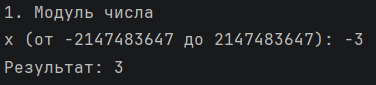

### Задача 3 Тридцать пять

#### Текст задачи

Дана сигнатура метода: public bool is35 (int x); Необходимо реализовать метод таким образом, чтобы он возвращал true, если число x делится нацело на 3 или 5. При этом, если оно делится и на 3, и на 5, то вернуть надо false. Подсказка: оператор % позволяет получить остаток от деления.

Пример 1:

x=5

результат: true

Пример 2:

x=8

результат: false

Пример 3:

x=15

результат: false

#### Алгоритм решения

1. Ввести целое число и проверить ввод и допустимый диапазон.

2. Проверить, делится ли число без остатка на 3.

3. Проверить, делится ли число без остатка на 5.

4. Если число делится только на одно из этих чисел, вывести истину. Если на оба или ни на одно — вывести ложь.

#### Тестирование

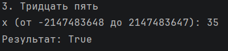

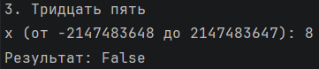

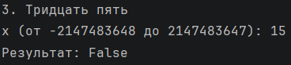

### Задача 5 Тройной максимум

#### Текст задачи

Дана сигнатура метода: public int max3 (int x, int y, int z); Необходимо реализовать метод таким образом, чтобы он возвращал максимальное из трех полученных методом чисел. Подсказка: идеальное решение включает всего две инструкции if и не содержит вложенных if.

Пример 1:

x=5 y=7 z=7

результат: 7

Пример 2:

x=8 y=-1 z=4

результат: 8

#### Алгоритм решения

1. Ввести три целых числа и проверить ввод и допустимый диапазон.

2. Считать первое число наибольшим.

3. Если второе число больше выбранного, запомнить второе число.

4. Если третье число больше выбранного, запомнить третье число.

5. Вывести найденное наибольшее число.

#### Тестирование

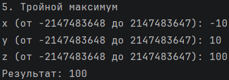

### Задача 7 Двойная сумма

#### Текст задачи

Дана сигнатура метода: public int sum2 (int x, int y); Необходимо реализовать метод таким образом, чтобы он возвращал сумму чисел x и y. Однако, если сумма попадает в диапазон от 10 до 19, то надо вернуть число 20.

Пример 1:

x=5 y=7

результат: 20

Пример 2:

x=8 y=-1

результат: 7

#### Алгоритм решения

1. Ввести два целых числа и проверить ввод. Выбрать допустимый диапазон, при котором сумма помещается в тип int.

2. Сложить введённые числа.

3. Если сумма находится в диапазоне от 10 до 19 включительно, заменить её числом 20.

4. Вывести результат.

#### Тестирование

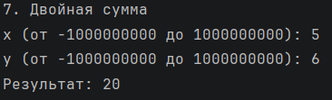

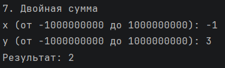

### Задача 9 День недели

#### Текст задачи

Дана сигнатура метода: public String day (int x); Метод принимает число x, обозначающее день недели. Необходимо реализовать метод таким образом, чтобы он возвращал строку, которая будет обозначать текущий день недели, где 1- это понедельник, а 7 – воскресенье. Если число не от 1 до 7 то верните текст “это не день недели”. Вместо if в данной задаче используйте switch.

Пример:

x=5

результат: “пятница”

#### Алгоритм решения

1. Ввести целое число и проверить правильность ввода и диапазон типа int.

2. Выбрать название дня по номеру с помощью выбора одного из вариантов: 1 — понедельник, 2 — вторник, 3 — среда, 4 — четверг, 5 — пятница, 6 — суббота, 7 — воскресенье.

3. Для любого другого целого числа выбрать сообщение «это не день недели».

4. Вывести выбранный текст.

#### Тестирование

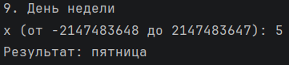

## Задание 3

### Задача 1 Числа подряд

#### Текст задачи

Дана сигнатура метода: public String listNums (int x); Необходимо реализовать метод таким образом, чтобы он возвращал строку, в которой будут записаны все числа от 0 до x (включительно).

Пример:

x=5

результат: “0 1 2 3 4 5”

#### Алгоритм решения

1. Ввести целое неотрицательное число и проверить ввод и допустимый верхний предел.

2. Начать с числа 0.

3. Последовательно добавлять в строку очередное число и переходить к следующему.

4. Закончить после добавления введённого числа.

5. Вывести строку чисел, разделённых пробелами.

#### Тестирование

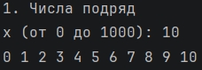

### Задача 3 Четные числа

#### Текст задачи

Дана сигнатура метода: public String chet (int x); Необходимо реализовать метод таким образом, чтобы он возвращал строку, в которой будут записаны все четные числа от 0 до x (включительно). Подсказа для обеспечения качества кода: инструкцию if использовать не следует.

Пример:

x=9

результат: “0 2 4 6 8”

#### Алгоритм решения

1. Ввести целое неотрицательное число и проверить ввод и допустимый верхний предел.

2. Начать с числа 0 и добавить его в строку.

3. Каждый раз увеличивать число на 2 и добавлять его в строку, пока оно не превышает введённую границу.

4. Вывести строку чётных чисел, разделённых пробелами.

#### Тестирование

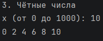

### Задача 5 Длина числа

#### Текст задачи

Дана сигнатура метода: public int numLen (long x); Необходимо реализовать метод таким образом, чтобы он возвращал количество знаков в числе x. Подсказка: Int у=123/10; // у будет иметь значение 12

Пример:

x=12567

результат: 5

#### Алгоритм решения

1. Ввести целое число типа long и проверить правильность ввода и допустимый диапазон.

2. Если введён ноль, количество цифр равно 1.

3. Для ненулевого числа начать счётчик с нуля.

4. Последовательно делить число на 10 с отбрасыванием дробной части. После каждого деления увеличивать счётчик на 1. Продолжать, пока число не станет нулём.

5. Вывести счётчик. Знак минус не считать цифрой.

#### Тестирование

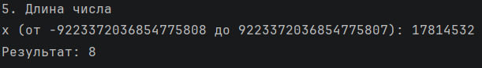

### Задача 7 Квадрат

#### Текст задачи

Дана сигнатура метода: public void square (int x); Необходимо реализовать метод таким образом, чтобы он выводил на экран квадрат из символов ‘\*’ размером х, у которого х символов в ряд и х символов в высоту.

Пример 1:

x=2

результат:

\*\*

\*\*

Пример 2:

x=4

результат:

\*\*\*\*

\*\*\*\*

\*\*\*\*

\*\*\*\*

#### Алгоритм решения

1. Ввести положительный целый размер квадрата и проверить ввод и допустимый верхний предел.

2. Вывести строку из указанного количества звёздочек.

3. Перейти на новую строку.

4. Повторить вывод строки столько раз, сколько указано в размере квадрата.

#### Тестирование

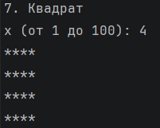

### Задача 9 Правый треугольник

#### Текст задачи

Дана сигнатура метода: public void rightTriangle (int x); Необходимо реализовать метод таким образом, чтобы он выводил на экран треугольник из символов ‘\*’ у которого х символов в высоту, а количество символов в ряду совпадает с номером строки, при этом треугольник выровнен по правому краю. Подсказка: перед символами ‘\*’ следует выводить необходимое количество пробелов.

Пример 1:

x=3

результат:

\*

\*\*

\*\*\*

Пример 2:

x=4

результат:

\*

\*\*

\*\*\*

\*\*\*\*

#### Алгоритм решения

1. Ввести положительную целую высоту треугольника и проверить ввод и допустимый верхний предел.

2. Перебирать строки от первой до последней.

3. В каждой строке сначала вывести пробелы: их количество равно высоте минус номер строки.

4. Затем вывести столько звёздочек, каков номер строки, и перейти на новую строку.

5. Повторить эти действия для всех строк.

#### Тестирование

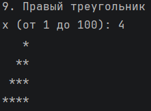

## Задание 4

### Задача 1 Поиск первого значения

#### Текст задачи

Дана сигнатура метода: public int findFirst (int\[\] arr, int x); Необходимо реализовать метод таким образом, чтобы он возвращал индекс первого вхождения числа x в массив arr. Если число не входит в массив – возвращается -1.

Пример:

arr=\[1,2,3,4,2,2,5\]

x=2

результат: 1

#### Алгоритм решения

1. Ввести длину массива, его элементы и искомое число. Проверить ввод, допустимую длину и диапазон элементов.

2. Просматривать массив с первого элемента. Индексы начинаются с нуля.

3. Сравнивать каждый элемент с искомым числом.

4. При первом совпадении запомнить индекс и закончить поиск.

5. Если совпадений нет, результат равен −1.

6. Вывести результат.

#### Тестирование

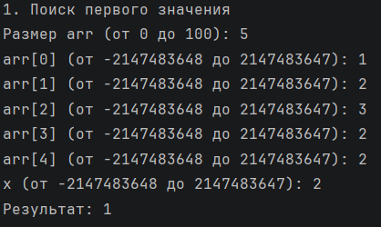

### Задача 3 Поиск максимального

#### Текст задачи

Дана сигнатура метода: public int maxAbs (int\[\] arr); Необходимо реализовать метод таким образом, чтобы он возвращал наибольшее по модулю (то есть без учета знака) значение массива arr.

Пример:

arr=\[1,-2,-7,4,2,2,5\]

результат: -7

#### Алгоритм решения

1. Ввести положительную длину массива и его целые элементы. Проверить ввод и допустимые диапазоны.

2. Запомнить первый элемент как текущий результат.

3. Просматривать остальные элементы и сравнивать их модули с модулем текущего результата.

4. Если модуль очередного элемента больше, запомнить этот элемент вместе с его знаком. При равенстве оставить ранее выбранный.

5. Вывести найденный элемент.

#### Тестирование

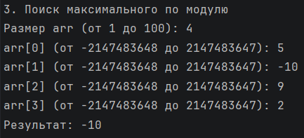

### Задача 5 Добавление массива в массив

#### Текст задачи

Дана сигнатура метода: public int\[\] add (int\[\] arr, int\[\] ins, int pos); Необходимо реализовать метод таким образом, чтобы он возвращал новый массив, который будет содержать все элементы массива arr, однако в позицию pos будут вставлены значения массива ins.

Пример:

arr=\[1,2,3,4,5\]

ins=\[7,8,9\]

pos=3

результат: \[1,2,3,7,8,9,4,5\]

#### Алгоритм решения

1. Ввести длины и элементы двух массивов, а также позицию вставки. Проверить ввод, диапазоны и что позиция находится от нуля до длины первого массива включительно.

2. Создать новый массив длиной, равной сумме длин исходных массивов.

3. Перенести в него элементы первого массива, стоящие перед позицией вставки.

4. Следом перенести все элементы второго массива в исходном порядке.

5. Перенести оставшиеся элементы первого массива.

6. Вывести новый массив.

#### Тестирование

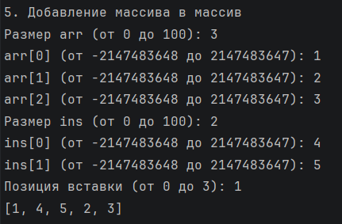

### Задача 7 Возвратный реверс

#### Текст задачи

Дана сигнатура метода: public int\[\] reverseBack (int\[\] arr); Необходимо реализовать метод таким образом, чтобы он возвращал новый массив, в котором значения массива arr записаны задом наперед.

Пример:

arr=\[1,2,3,4,5\]

результат: \[5,4,3,2,1\]

#### Алгоритм решения

1. Ввести длину массива и его элементы. Проверить правильность ввода, допустимую длину и диапазон элементов.

2. Создать новый массив такой же длины.

3. Перенести последний элемент исходного массива на первое место нового, предпоследний — на второе и так далее.

4. Продолжать, пока все элементы не будут перенесены. Исходный массив сохранить.

5. Вывести новый массив.

#### Тестирование

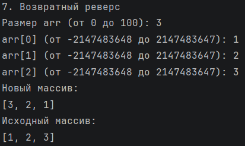

### Задача 9 Все вхождения

#### Текст задачи

Дана сигнатура метода: public int\[\] findAll (int\[\] arr, int x); Необходимо реализовать метод таким образом, чтобы он возвращал новый массив, в котором записаны индексы всех вхождений числа x в массив arr.

Пример:

arr=\[1,2,3,8,2,2,9\]

x=2

результат: \[1,4,5\]

#### Алгоритм решения

1. Ввести длину массива, его элементы и искомое число. Проверить ввод, длину и диапазон значений.

2. Просмотреть массив и посчитать количество совпадений с искомым числом.

3. Создать новый массив такой длины, каково количество совпадений.

4. Ещё раз просмотреть исходный массив и записать в новый массив индексы всех совпадений по порядку. Индексы начинаются с нуля.

5. Вывести массив индексов. Если совпадений нет, вернуть пустой массив.

#### Тестирование

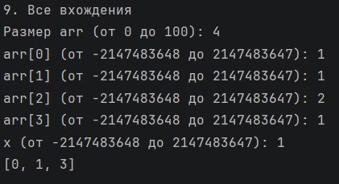
